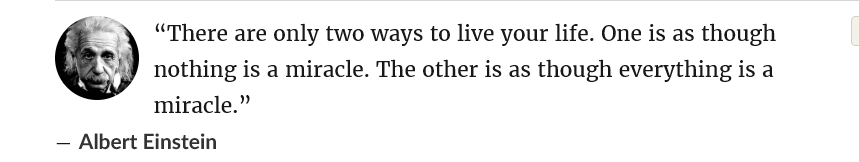

# Ahmad Dharmawan

First-semester Informatics Engineering student. Learning ML and software engineering. Goal: FAANG. Call me mawan.

---

## Who I Am

I'm **Ahmad Dharmawan** — first-semester **Informatics Engineering** student, self-taught in ML and software engineering. Still learning. I read the source, break things on purpose to understand them, and debug tensor shapes late at night. Goal: land a role at a **FAANG** company.

**What I'm doing about it:**
- 📚 Foundations — data structures, algorithms, systems, and the math underneath ML, through my degree
- 🧠 Machine Learning — PyTorch, deep learning, training pipelines
- ⚙️ Software Engineering — clean code, APIs, Docker, Git, CI/CD
- 🚀 FAANG prep — LeetCode, system design, building a real portfolio

---

## Inspiration

**Andrej Karpathy** is the through-line. His repo — `micrograd`, `llm.c`, the nanoGPT walkthroughs — is the clearest argument I've seen for understanding the stack all the way down. He doesn't just ship models; he ships the intuition behind them. That's the engineer I want to become.

---

## On Perspective

  

> *"There are only two ways to live your life. One is as though nothing is a miracle. The other is as though everything is a miracle."*
> — Albert Einstein

---

## Tech

| Area | Tools |
|------|-------|
| Languages | C, Python, JavaScript, SQL |
| ML / DL | PyTorch, NumPy, scikit-learn |
| Backend | Node.js, REST APIs, Docker |
| DevOps | Git, GitHub Actions, Linux |

---

## What I'm Building

Soon.

---

## Goal

Land a software engineering or ML engineering role at a **FAANG** company.

---

## Links

- [GitHub: @mawannnn](https://github.com/mawannnn)
- [Andrej Karpathy](https://github.com/karpathy)
- [LinkedIn](https://www.linkedin.com/)
>>>>>>> ce5cd47 (feat: rewrite profile README)
